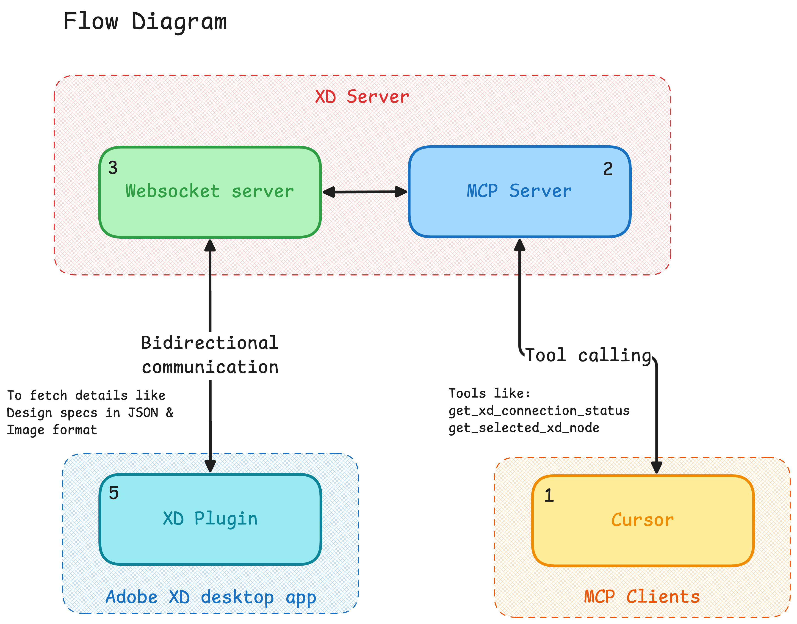

# XD Ecosystem

A comprehensive ecosystem for bridging Adobe XD with AI assistants and Large Language Models (LLMs), enabling real-time design data extraction and AI-powered design workflows.

## 🏗️ Architecture Overview

The XD Ecosystem consists of two core components that work together to enable AI-powered design workflows:

### 🔌 [XD Plugin](./xd-plugin/)
Adobe XD plugin that extracts design specifications and communicates with external services.

**[📖 Read Plugin Documentation →](./xd-plugin/README.md)**

### 🌐 [XD Server](./xd-server/)
MCP (Model Context Protocol) server that bridges XD plugins with LLMs using real-time WebSocket communication.

**[📖 Read Server Documentation →](./xd-server/README.md)**

## 🔄 How It Works

### **Flow Diagram**



1. **AI Assistant** calls MCP tools (e.g., "get selected XD node")
2. **MCP Server** processes request via EventEmitter pattern
3. **WebSocket Bridge** sends real-time request to XD
4. **XD Plugin** extracts design data and responds
5. **Response flows back** through the chain to the AI

### Sequence Diagram


## 🚀 Quick Start

1. **XD Plugin & XD Server Setup**:

    ```bash
    # This command will setup XD Plugin as well as XD Server
    npm run setup
    ```

2. **Start MCP Server**:

    ```bash
    xd-server
    ```

3. Configure LLM Client
Configure your MCP-compatible LLM client (Claude Desktop, Cursor, etc.) with:
- **Endpoint**: `http://localhost:4000/mcp`
- **Detailed setup**: See [XD Server Setup Guide](./xd-server/SETUP.md)

## 📋 Prerequisites

-   **Adobe XD**
-   **Node.js** 22.0.0 or higher
-   **MCP-compatible LLM client** (Claude Desktop, Cursor, etc.)

## 💡 What You Can Do

- **🤖 AI-Powered Design Analysis**: Get intelligent insights about your XD designs
- **📝 Design System Documentation**: Automatically extract design tokens and specifications
- **⚡ Code Generation**: Generate CSS/SCSS directly from XD designs
- **🔄 Design-to-Code Workflows**: Seamlessly bridge design and development processes

## 🛠️ Development

Each component has detailed development guides:

- **XD Plugin**: [Development Guide](./xd-plugin/README.md#development)
- **XD Server**: [Development Guide](./xd-server/README.md#development)

## 🤝 Contributing

1. Fork the repository
2. Create a feature branch
3. Make your changes
4. Test with both XD Plugin and XD Server
5. Submit a pull request

## 📄 License

MIT License - see [LICENSE](./LICENSE) file for details.
