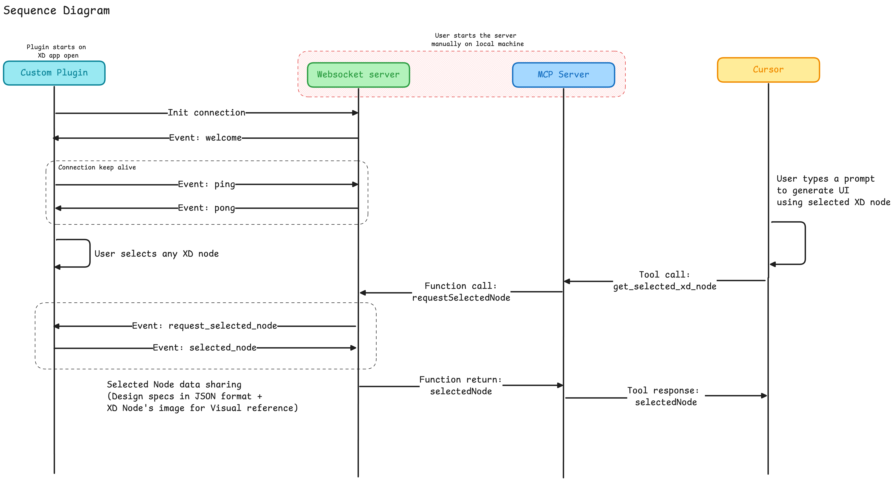

# XD 2 LLM

A comprehensive ecosystem for bridging Adobe XD with AI assistants and Large Language Models (LLMs), enabling real-time design data extraction and AI-powered design workflows.

## 🏗️ Architecture Overview

XD 2 LLM consists of two core components that work together to enable AI-powered design workflows:

### 🔌 [XD Context Extractor](./xd-context-extractor/)

Adobe XD plugin that extracts design specifications and communicates with external services.

**[📖 Read Plugin Documentation →](./xd-context-extractor/README.md)**

### 🌐 [XD LLM Connector](./xd-llm-connector/)

MCP (Model Context Protocol) server that bridges XD plugins with LLMs using real-time WebSocket communication.

**[📖 Read Server Documentation →](./xd-llm-connector/README.md)**

## 🔄 How It Works

### **Flow Diagram**

<p align="center">
    
</p>

1. **AI Assistant** calls MCP tools (e.g., "get selected XD node")
2. **MCP Server** processes request via EventEmitter pattern
3. **WebSocket Bridge** sends real-time request to XD
4. **XD Plugin** extracts design data and responds
5. **Response flows back** through the chain to the AI

### Sequence Diagram

<p align="center">
    
</p>

## 🚀 Quick Start

1. **XD Context Extractor & XD LLM Connector Setup**:

    ```bash
    # This command will setup XD Context Extractor as well as XD LLM Connector
    npm run setup
    ```

2. **Start MCP Server**:

    ```bash
    xd-llm-connector
    ```

3. Configure LLM Client
   Configure your MCP-compatible LLM client (Claude Desktop, Cursor, etc.) with:

-   **Endpoint**: `http://localhost:4000/mcp`
-   **Detailed setup**: See [XD LLM Connector Setup Guide](./xd-llm-connector/SETUP.md)

## 📋 Prerequisites

-   **Adobe XD**
-   **Node.js** 22.0.0 or higher
-   **MCP-compatible LLM client** (Claude Desktop, Cursor, etc.)

## 💡 What You Can Do

-   **🤖 AI-Powered Design Analysis**: Get intelligent insights about your XD designs
-   **📝 Design System Documentation**: Automatically extract design tokens and specifications
-   **⚡ Code Generation**: Generate CSS/SCSS directly from XD designs
-   **🔄 Design-to-Code Workflows**: Seamlessly bridge design and development processes

## 📊 Performance Results

XD 2 LLM delivers exceptional improvements over traditional AI-generated skeletons:

-   **+50% Average Accuracy Improvement** across all complexity levels
-   **60-90% Structure Accuracy** achieved with XD 2 LLM
-   **Consistent Performance** from easy to hard complexity components

**[📈 View Detailed Results & Comparisons →](./RESULTS.md)**

## 🛠️ Development

Each component has detailed development guides:

-   **XD Context Extractor**: [Development Guide](./xd-context-extractor/README.md#development)
-   **XD LLM Connector**: [Development Guide](./xd-llm-connector/README.md#development)

## 🤝 Contributing

1. Fork the repository
2. Create a feature branch
3. Make your changes
4. Test with both XD Context Extractor and XD LLM Connector
5. Submit a pull request

## 📄 License

MIT License - see [LICENSE](./LICENSE) file for details.

<style>
.image {
    max-width: 100%;
    width: auto;
    height: 400px;
    object-fit: cover;
    border-radius: 4px;
    align: center;
}
</style>
